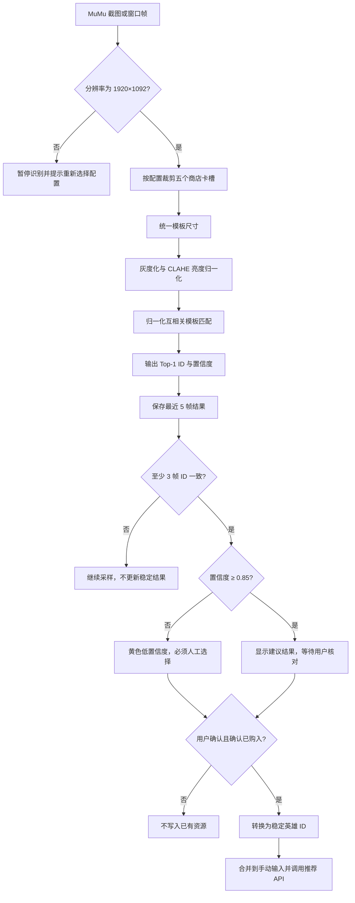

# 视觉识别流程图与异常规则

## 1. 主流程

## 2. 固定参数

| 参数 | 当前值 | 说明 |
| --- | --- | --- |
| 配置 | `mumu-6.8.7-shop-1920x1092` | 只用于已验证环境 |
| 采样频率 | 1 FPS | 第二周设计值，后续可调至 2 FPS |
| 匹配阈值 | 0.85 | 未达到时强制人工确认 |
| 稳定窗口 | 最近 5 帧 | 防止动画瞬时误判 |
| 最少一致帧 | 3 帧 | 未达到时不更新结果 |
| 首版算法 | 灰度 + CLAHE + 模板匹配 | 不使用 OCR，不读取游戏内存 |

## 3. 异常与降级

- 分辨率、DPI 或商店布局变化：暂停并重新标定，禁止静默沿用坐标。
- 窗口最小化、截图为空或卡槽被遮挡：标记识别失败，不产生英雄 ID。
- 多个模板得分接近：显示候选列表，由用户选择。
- 商店英雄只代表可购买候选，不代表已经拥有；用户必须确认“已购入”。
- 识别模块不可用时切换到手动输入，推荐功能仍可演示。

## 4. 模块边界

视觉模块只输出候选 ID、置信度、卡槽和确认状态。前端负责人工确认，后端只接收已确认的稳定 ID；视觉模块不直接操作游戏，也不直接调用推荐评分逻辑。

