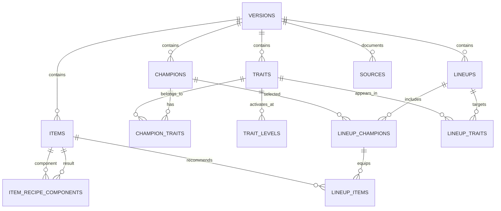

# 数据库设计 V1

## 1. 设计目标

数据库用于保存 S18「自然之力」的版本化英雄、羁绊、装备、阵容及来源信息。V1 采用 SQLite，满足本地演示、无网络运行、数据可追溯和后续版本隔离需求。

当前程序仍可直接读取 JSON 快照；SQLite 是下一阶段的数据持久化目标。可执行建表文件位于 `backend/app/db/schema.sql`。

## 2. 设计原则

1. 同一实体的业务 ID 只要求在版本内唯一，避免不同版本互相覆盖。
2. 英雄、羁绊、阵容和装备之间使用关联表，不在数据库中保存逗号分隔 ID。
3. 删除版本时级联删除该版本数据；仍被阵容引用的英雄、装备和羁绊不得单独删除。
4. 来源信息独立保存，能够追踪网页、采集时间和采集方式。
5. 胜率和前四率统一保存为 0–1 小数；平均排名限制在 1–8。
6. `role_tags_json` 只保存非关键扩展标签；核心关联必须使用关系表。

## 3. 实体关系

## 4. 表职责

| 表 | 主键/唯一约束 | 职责 |
| --- | --- | --- |
| `versions` | `id`；赛季与版本唯一 | 数据快照根节点 |
| `champions` | `id`；版本内 `stable_id` 唯一 | 英雄基础信息 |
| `traits` | `id`；版本内 `stable_id` 唯一 | 羁绊基础信息 |
| `trait_levels` | 羁绊与触发人数唯一 | 羁绊档位与效果 |
| `champion_traits` | 英雄与羁绊联合主键 | 英雄羁绊多对多关系 |
| `items` | `id`；版本内 `stable_id` 唯一 | 散件、成装和特殊装备 |
| `item_recipe_components` | 成装与散件联合主键 | 配方及相同散件数量 |
| `lineups` | `id`；版本内 `stable_id` 唯一 | 阵容及公开统计快照 |
| `lineup_traits` | 阵容与羁绊联合主键 | 阵容主要羁绊 |
| `lineup_champions` | 阵容与英雄联合主键 | 站位、核心标记、目标星级 |
| `lineup_items` | 阵容、英雄、装备联合主键 | 阵容内装备分配、优先级和重复数量 |
| `sources` | 版本、实体、URL 唯一 | 来源与采集审计 |

## 5. JSON 到数据库映射

| JSON 文件 | 目标表 |
| --- | --- |
| `versions.json` | `versions` |
| `champions.json` | `champions`、`champion_traits` |
| `traits.json` | `traits`、`trait_levels` |
| `items.json` | `items`、`item_recipe_components` |
| `lineups.json` | `lineups`、`lineup_traits`、`lineup_champions`、`lineup_items` |
| `sources/*.json` | `sources` |

导入必须在一个事务内完成：先版本，再基础实体，最后关联表。任何外键或唯一约束失败时整批回滚，旧快照保持可用。

## 6. 查询与索引

- 英雄列表按 `version_id + cost` 过滤，并支持名称搜索。
- 装备列表按 `version_id + kind` 过滤，并支持名称搜索。
- 阵容按 `version_id + tier` 过滤。
- `lineup_champions(champion_id)` 支持反查某英雄出现在哪些阵容。
- `sources(version_id, entity_type, entity_stable_id)` 支持来源追踪。

V1 数据量较小，不引入全文检索和缓存。性能不足时再增加 FTS5 或应用层缓存。

## 7. 完整性与版本隔离

- SQLite 连接建立后必须执行 `PRAGMA foreign_keys = ON`。
- 费用限制为 1–5，目标星级限制为 1–3，棋盘区域限制为 `front/middle/back`。
- 阵容统计的样本量必须大于 0。
- 不允许跨版本建立关联；导入器应先验证关联实体的 `version_id` 一致。
- 当前 JSON 校验继续由 `scripts/validate_sample_data.py` 完成，SQL 结构由 `backend/tests/test_database_schema.py` 验证。

## 8. 后续实现顺序

1. 编写 JSON → SQLite 初始化脚本。
2. 为只读查询增加 Repository 实现。
3. 让 JSON Repository 与 SQLite Repository 使用相同接口。
4. 完成结果一致性测试后，将默认数据源切换为 SQLite。
