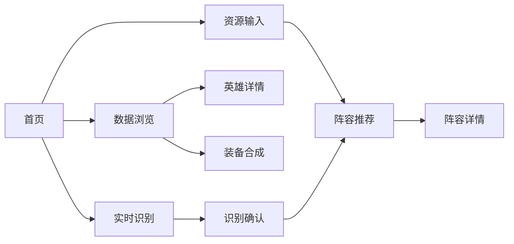

# 界面低保真原型 V1

## 1. 页面导航



## 2. 首页

```text
┌────────────────────────────────────────────────────────────┐
│ 金铲铲·自然之力助手          S18 / 18.4      数据 10 套阵容 │
├────────────────────────────────────────────────────────────┤
│                                                            │
│  根据已有英雄与装备，推荐可以转型的阵容                    │
│                                                            │
│  [开始手动选择]        [从截图识别]                         │
│                                                            │
│  功能：装备合成｜英雄查询｜阵容推荐｜阵容分析              │
├────────────────────────────────────────────────────────────┤
│ 数据快照：2026-10-19     说明：仅作课程研究与决策辅助       │
└────────────────────────────────────────────────────────────┘
```

## 3. 资源输入页

```text
┌────────────────────────────────────────────────────────────┐
│ < 返回                    当前输入                          │
├──────────────────────────────┬─────────────────────────────┤
│ 英雄                         │ 已选择                       │
│ [搜索英雄________] [费用▼]   │ 英雄：韦鲁斯 ×               │
│                              │       凯尔 ×                 │
│ [头像] 韦鲁斯 1费   [+]      │ 装备：暴风大剑 ×2            │
│ [头像] 凯尔   2费   [+]      │       女神之泪 ×             │
│ [头像] 瑟庄妮 2费   [+]      │                             │
├──────────────────────────────┤                             │
│ 装备                         │ Top K [3 ▼]                 │
│ [散件] [成装] [搜索____]     │                             │
│ [图标] 暴风大剑 [+]          │ [生成阵容推荐]               │
│ [图标] 女神之泪 [+]          │ [清空]                       │
└──────────────────────────────┴─────────────────────────────┘
```

交互要求：相同装备可以重复添加；英雄不能重复；未知或跨版本 ID 在提交前提示。

## 4. 推荐结果页

```text
┌────────────────────────────────────────────────────────────┐
│ 推荐结果                         [修改输入] [重新计算]       │
├────────────────────────────────────────────────────────────┤
│ 1  射箭韦鲁斯      综合分 78.4        S                    │
│ 英雄匹配 ████████░░  装备适配 ███████░░░                   │
│ 羁绊就绪 ████████░░  公开强度 ███████░░░                   │
│ 已有：韦鲁斯、凯尔     缺少核心：瑟庄妮、慎、蕾欧娜       │
│ 可合成：朔极之矛、巨人捕手                                 │
│ 理由：已有 2 名核心；现有散件可合成两件推荐装备            │
│ [查看详情]                                                 │
├────────────────────────────────────────────────────────────┤
│ 2  卡丽蜜儿        综合分 64.2        A      [查看详情]     │
├────────────────────────────────────────────────────────────┤
│ 3  森林妖姬天使   综合分 57.8        C      [查看详情]     │
└────────────────────────────────────────────────────────────┘
```

## 5. 阵容详情页

```text
┌────────────────────────────────────────────────────────────┐
│ 射箭韦鲁斯 / S18 18.4 / S                  [返回推荐列表]   │
├──────────────────────────────┬─────────────────────────────┤
│ 站位示意                     │ 核心与装备                  │
│ 后排  韦鲁斯  月男  凯尔     │ 韦鲁斯：无尽/青龙刀/锐利   │
│ 中排  慎  洛  蕾欧娜         │ 凯尔：鬼索/珠光/巨人捕手   │
│ 前排  瑟庄妮  黛安娜         │ 瑟庄妮：振奋/石像鬼/狂徒   │
├──────────────────────────────┼─────────────────────────────┤
│ 主要羁绊                     │ 数据快照                    │
│ 日蚀骑士 / 迅捷射手 / 护卫   │ 平均排名：3.91             │
│ 月蚀骑士 / 重装战士 / 主宰   │ 前四率：60.5%              │
│                              │ 样本量：3,253              │
├──────────────────────────────┴─────────────────────────────┤
│ 缺口与风险：缺少 3 名核心；前排尚未成型                    │
│ 数据来源：[查看公开来源]                                   │
└────────────────────────────────────────────────────────────┘
```

## 6. 视觉确认页

```text
┌────────────────────────────────────────────────────────────┐
│ 实时识别                 状态：已暂停       [继续识别]      │
├──────────────────────────────┬─────────────────────────────┤
│ 截图预览                     │ 待确认结果                  │
│                              │ ✓ 韦鲁斯  93% [修改] [删除] │
│       [游戏区域截图]         │ ? 凯尔    61% [选择候选▼]   │
│                              │ ✓ 暴风大剑 89% [修改]       │
│                              │                             │
│                              │ [确认并进入推荐]            │
└──────────────────────────────┴─────────────────────────────┘
```

低于阈值的结果使用黄色问号标记，不允许未经确认直接请求推荐。

## 7. 通用状态

- 加载：按钮禁用并显示“正在计算推荐…”。
- 空输入：允许计算，但提示结果主要依据公开强度，建议至少选择一个资源。
- 无候选：展示原因和“返回修改输入”，不伪造阵容。
- 后端失败：保留用户当前选择，提供重试按钮。
- 视觉失败：提供“切换到手动输入”，不阻断演示。
