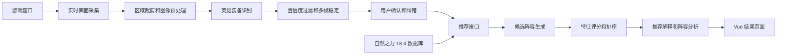
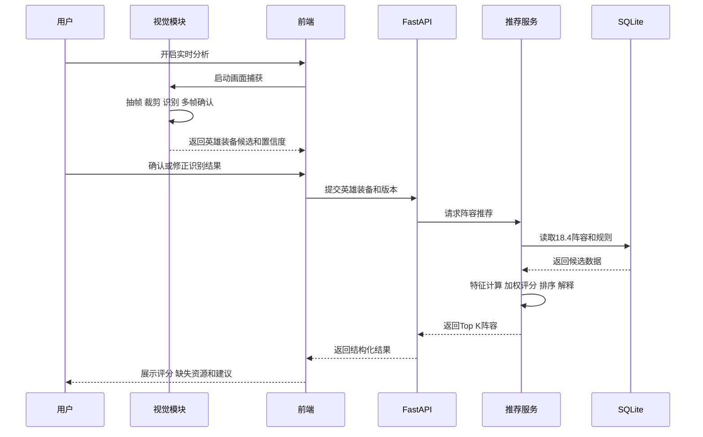
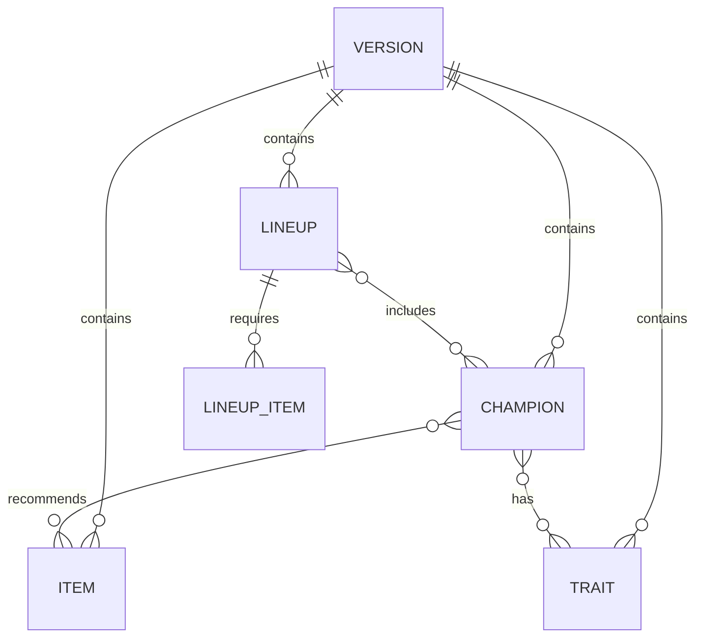

# 金铲铲之战自然之力智能推荐系统总体设计

## 1 设计目标

本系统面向《金铲铲之战》S18「自然之力」18.4 版本，通过实时画面采集、英雄装备识别、人工确认、阵容推荐和可解释分析，形成完整的游戏决策辅助流程。

系统只读取屏幕画面，不读取游戏进程内存，不模拟点击、购买或其他游戏操作。首个版本优先保证本地运行、结果可解释和课堂演示稳定，再逐步提高识别范围与推荐精度。

## 2 总体技术方案

| 层次 | 技术 | 主要职责 |
| --- | --- | --- |
| 前端层 | Vue 3、Vite | 资源选择、实时识别确认、推荐结果和阵容分析展示 |
| 接口层 | FastAPI、Pydantic | 提供查询、识别确认、推荐和分析接口 |
| 业务层 | Python | 装备合成、羁绊计算、候选生成、评分排序和解释生成 |
| 视觉层 | OpenCV | 游戏窗口捕获、定时抽帧、区域裁剪和模板匹配 |
| 模型扩展 | YOLO 可选 | 模板匹配无法满足要求时进行目标检测 |
| 数据层 | SQLite、JSON | 保存版本化英雄、装备、羁绊、阵容和推荐配置 |
| 测试层 | Pytest、Vitest | 验证算法、接口和前端组件 |

## 3 系统架构



系统划分为六个核心模块：

1. 数据管理模块：维护英雄、装备、羁绊、阵容和版本信息。
2. 实时视觉模块：捕获游戏窗口并识别指定区域中的英雄和装备。
3. 输入确认模块：显示识别候选和置信度，允许用户修正。
4. 推荐算法模块：根据已有资源生成候选阵容并进行评分排序。
5. 阵容分析模块：计算羁绊、阵容结构、缺失资源和调整建议。
6. 前端展示模块：统一展示数据、识别状态、推荐结果和解释信息。

## 4 核心业务流程



实时分析采用事件驱动方式。视觉模块每 0.5 至 1 秒处理一帧，但只有识别结果连续多帧稳定或用户主动确认后，才触发新的推荐计算，避免页面频繁抖动和重复请求。

## 5 模块详细设计

### 5.1 数据管理模块

数据管理模块负责：

- 读取自然之力 18.4 的英雄、装备、羁绊和阵容数据。
- 校验同版本数据的唯一性和引用完整性。
- 保存数据来源、采集时间和版本信息。
- 为推荐算法提供统一 ID，避免依赖中文名称关联。
- 支持未来新增版本快照，不覆盖 18.4 基准数据。

初期使用 JSON 或 CSV 完成采集与人工核对，再通过导入脚本写入 SQLite。程序运行时只读取清洗后的本地数据，不实时依赖第三方网站。

### 5.2 实时画面采集模块

实时画面采集限定在电脑或安卓模拟器环境。模块通过窗口标题或用户选择确定目标窗口，然后执行：

1. 获取游戏窗口客户区画面。
2. 按当前分辨率缩放到统一坐标系。
3. 根据配置裁剪商店区、备战区或装备区。
4. 每 0.5 至 1 秒向识别模块提交一帧。
5. 游戏窗口最小化、尺寸变化或捕获失败时暂停识别并提示用户。

首个版本只支持一个经过测试的分辨率和界面布局。不同分辨率通过独立配置文件维护裁剪区域，不在代码中写死坐标。

### 5.3 英雄装备识别模块

识别方案按开发难度分为两级：

- 基础方案：固定区域裁剪加模板匹配或图像特征相似度，适合英雄头像和装备图标。
- 扩展方案：使用 YOLO 检测目标位置和类别，适合区域位置变化较大的场景。

系统优先完成基础方案。每个识别结果包含实体 ID、名称、类别、置信度、画面区域和帧时间。结果需要满足置信度阈值，并在最近若干帧中达到一致，才标记为稳定结果。

置信度不足、多个候选接近或没有对应数据时，结果进入人工确认列表。用户修正只改变本次推荐输入，不自动修改模型标签。

### 5.4 推荐算法模块

推荐模块接收当前版本、已有英雄和已有装备，先筛选同版本的有效阵容模板，再计算以下五项特征：

| 特征 | 初始权重 | 计算重点 |
| --- | ---: | --- |
| 英雄匹配度 | 35% | 已有英雄对目标阵容的覆盖程度，核心英雄权重更高 |
| 装备适配度 | 25% | 已有基础装备和成装与核心英雄需求的匹配程度 |
| 羁绊完整度 | 20% | 已有英雄可形成的羁绊层级及补全后的收益 |
| 结构完整度 | 15% | 前排、物理输出、法术输出、控制和续航是否均衡 |
| 成型难度 | 5% | 缺少英雄数量、高费核心数量和装备缺口 |

各分项归一化为 0 至 100 分，再按配置权重计算综合分。算法输出 Top 3 候选阵容；候选不足时返回实际数量和原因。

推荐理由由真实计算结果生成，例如已有英雄数量、适配装备数量、关键缺口和结构短板。不得生成与分项得分不一致的固定文案。

### 5.5 阵容分析模块

阵容分析包括：

- 统计当前和目标阵容的羁绊层级。
- 标记主输出、主坦克、副输出、控制和辅助角色。
- 判断物理与法术输出是否过度单一。
- 识别缺少的关键英雄、关键装备和前排能力。
- 给出可执行的调整建议。

分析结果采用结构化字段返回，前端负责组合成卡片、标签和进度条，不在后端生成 HTML。

### 5.6 前端展示模块

前端包含以下页面：

| 页面 | 功能 |
| --- | --- |
| 首页 | 展示项目功能、当前赛季和版本 |
| 数据浏览 | 查询英雄、装备、羁绊和阵容 |
| 装备查询 | 查询装备合成和适用英雄 |
| 资源输入 | 手动选择已有英雄和装备 |
| 实时识别 | 查看游戏画面状态、识别候选和置信度 |
| 结果确认 | 修改或删除误识别结果 |
| 阵容推荐 | 展示 Top K 阵容和分项评分 |
| 阵容详情 | 展示羁绊、装备、缺失资源和调整建议 |

实时识别并不是唯一入口。视觉模块失败时，用户仍可通过手动选择完成全部推荐流程，保证课堂演示不被单点故障阻断。

## 6 数据库设计

### 6.1 核心实体关系



### 6.2 主要数据表

| 数据表 | 关键字段 | 用途 |
| --- | --- | --- |
| `versions` | `id season version released_at active` | 保存赛季版本 |
| `champions` | `id version_id name cost role skill` | 保存英雄信息 |
| `traits` | `id version_id name category description` | 保存羁绊信息 |
| `trait_levels` | `trait_id required_count effect` | 保存羁绊层级 |
| `champion_traits` | `champion_id trait_id` | 英雄与羁绊多对多关系 |
| `items` | `id version_id name type effect` | 保存基础装备和成装 |
| `item_recipes` | `item_id component_a_id component_b_id` | 保存装备配方 |
| `champion_items` | `champion_id item_id priority reason` | 保存英雄装备推荐 |
| `lineups` | `id version_id name difficulty description` | 保存阵容模板 |
| `lineup_champions` | `lineup_id champion_id role core` | 保存阵容英雄和定位 |
| `lineup_items` | `lineup_id champion_id item_id priority` | 保存阵容装备方案 |
| `sources` | `entity_type entity_id url collected_at` | 记录数据来源 |

运行日志和用户本次识别结果默认不长期保存。若后续保存历史分析，需要用户主动确认并新增独立表。

## 7 接口设计

统一接口前缀为 `/api/v1`，响应使用 JSON。

| 方法 | 路径 | 功能 |
| --- | --- | --- |
| GET | `/versions` | 查询可用版本 |
| GET | `/champions` | 按名称、费用或羁绊查询英雄 |
| GET | `/champions/{id}` | 查询英雄详情和推荐装备 |
| GET | `/items` | 查询装备列表 |
| GET | `/items/compose` | 根据两件基础装备查询成装 |
| GET | `/traits` | 查询羁绊和层级效果 |
| GET | `/lineups` | 查询阵容模板 |
| POST | `/recommendations` | 根据已有资源生成 Top K 阵容 |
| POST | `/lineups/analyze` | 分析用户提交的阵容 |
| POST | `/vision/confirm` | 提交用户确认后的识别结果 |
| GET | `/health` | 检查服务状态 |

### 7.1 推荐请求示例

```json
{
  "season": "s18",
  "version": "18.4",
  "champion_ids": ["champion_a", "champion_b"],
  "item_ids": ["item_a", "item_b"],
  "top_k": 3
}
```

### 7.2 推荐响应结构

```json
{
  "season": "s18",
  "version": "18.4",
  "recommendations": [
    {
      "lineup_id": "lineup_a",
      "name": "阵容名称",
      "total_score": 82.5,
      "scores": {
        "champion_match": 85,
        "item_fit": 80,
        "trait_completion": 90,
        "structure": 75,
        "difficulty": 60
      },
      "owned_champion_ids": [],
      "missing_champion_ids": [],
      "item_assignments": [],
      "reasons": [],
      "risks": []
    }
  ]
}
```

## 8 项目目录设计

```text
backend/
├─ app/
│  ├─ api/
│  ├─ core/
│  ├─ db/
│  ├─ models/
│  ├─ schemas/
│  ├─ services/
│  └─ main.py
└─ tests/

frontend/
├─ src/
│  ├─ api/
│  ├─ components/
│  ├─ stores/
│  ├─ views/
│  └─ router/
└─ tests/

vision/
├─ capture/
├─ recognition/
├─ configs/
├─ assets/
└─ tests/

data/
├─ raw/
├─ processed/
└─ sources/
```

推荐算法放在 `backend/app/services`，视觉识别保持为独立 Python 模块。视觉模块只能输出结构化识别结果，不直接访问推荐数据库，从而降低模块耦合。

## 9 异常处理

| 异常场景 | 系统处理 |
| --- | --- |
| 游戏窗口未找到 | 停止捕获并提示用户重新选择窗口 |
| 窗口分辨率不支持 | 提示切换分辨率或改用手动输入 |
| 识别置信度过低 | 标记为待确认，不触发自动推荐 |
| 没有匹配阵容 | 返回空列表和具体原因，不伪造结果 |
| 数据版本不一致 | 拒绝混合计算并提示重新选择版本 |
| 后端服务不可用 | 前端保留当前输入并显示重试按钮 |
| 第三方网站不可访问 | 使用已经冻结的本地 18.4 数据 |

## 10 性能和安全设计

- 视觉处理频率目标为每秒 1 至 2 帧。
- 普通查询响应目标不超过 2 秒。
- 推荐计算响应目标不超过 3 秒。
- 只有稳定识别结果变化时才重新计算推荐。
- 项目不保存游戏账号、密码或 GitHub Token。
- `.env`、原始录屏、模型权重和本地数据库不得提交到 GitHub。
- 不绕过登录、验证码、接口签名或网站访问限制采集数据。
- 报告和演示中注明数据及图片来源。

## 11 测试设计

### 11.1 单元测试

- 装备合成规则测试。
- 羁绊层级计算测试。
- 五项特征计算测试。
- 推荐排序稳定性测试。
- 多帧识别结果合并测试。

### 11.2 接口测试

- 正常参数、空输入、重复 ID 和未知 ID。
- 版本不存在和跨版本引用。
- Top K 超出候选数量。
- 响应字段和错误码一致性。

### 11.3 集成测试

- 手动输入到推荐结果的完整流程。
- 实时识别、人工修正到推荐更新的完整流程。
- 视觉模块停止后切换到手动输入。
- 服务重启后重新载入本地数据。

### 11.4 效果指标

- 推荐覆盖率。
- 人工标注合理阵容的 Top 3 命中率。
- 推荐解释与分项分数一致率。
- 规定场景下英雄和装备识别准确率。
- 识别结果人工修正率。
- 从稳定识别到结果更新的端到端延迟。

## 12 部署和演示方案

课堂演示采用单机本地部署：

1. SQLite 和清洗数据保存在本地。
2. FastAPI 在本机启动后端服务。
3. Vue 前端通过本地地址访问后端。
4. OpenCV 捕获指定游戏或模拟器窗口。
5. 网络只用于必要的 GitHub 操作，系统演示不依赖在线数据源。

演示准备三种输入方式：实时窗口、预置录屏或截图、手动选择。实时识别失败时可以立即切换，不中断推荐与阵容分析展示。

## 13 开发顺序

1. 建立少量但完整的 18.4 样例数据。
2. 完成数据库导入、装备查询和羁绊计算。
3. 实现推荐算法及接口，用自动化测试验证。
4. 使用模拟数据完成前端页面。
5. 完成手动输入到推荐结果的最小闭环。
6. 实现实时画面捕获和基础图标识别。
7. 加入多帧稳定、置信度和人工纠错。
8. 完成视觉结果与推荐接口联动。
9. 扩充数据，执行效果实验和集成测试。
10. 整理报告、PPT、演示脚本和备用视频。

## 14 当前设计结论

- 首个版本使用自然之力 18.4 本地快照，保证结果可复现。
- AI 推荐采用内容特征、规则约束和加权排序，强调可解释性。
- 实时视觉采用低帧率准实时分析，不追求 30 FPS 视频处理。
- 首先使用固定区域和模板匹配，只有在效果不足时引入 YOLO。
- 所有识别结果经过置信度过滤和用户确认，不直接控制游戏。
- 手动输入始终保留，作为视觉失败时的可靠替代路径。

